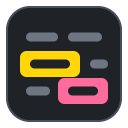
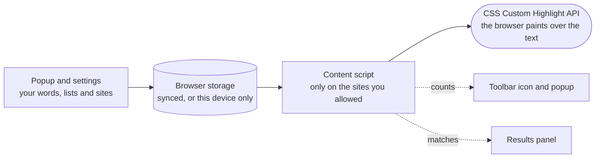

<div align="center">



# uHighlight

**Highlight the words that matter on every page.**

Lists for each site, every match in one panel,<br>
and what's new since you last looked.

<br>

[](https://chromewebstore.google.com/detail/uhighlight/dignifeemkblnjgepjimlglagckkeboj)


[](LICENSE)

<br>

<a href="https://chromewebstore.google.com/detail/uhighlight/dignifeemkblnjgepjimlglagckkeboj"></a>
&nbsp;
<a href="https://dasicx.com/uhighlight.html"></a>

<sub>Chrome · Edge · Brave and other Chromium browsers, version 119 or later</sub>

</div>

<br>

<table>
<tr>
<td width="58%" valign="top">

## Why uHighlight

Reading a long page for one thing is slow. Tell uHighlight the words that
matter to you (names, products, topics, warning signs) and they light up on
every page you read, each in its own color. A 5,000-word page becomes the
four lines you actually came for.

**Keep separate lists for separate jobs:** one for `github.com/*/issues/*`,
one for job boards, one for the specifications on a shop's product pages.

**See every match of a page in one panel,** under the page's own headings,
and click one to scroll straight to it.

**Catch what is new.** Mark a page's matches as reviewed, and next time
*New only* shows just what appeared since. Made for the pages you check
every day: advisories, ticket queues, listings, news.

**You decide where it runs:** on the sites you turn it on for, or everywhere
except the sites you leave out. It reads no site until you allow it.

</td>
<td width="42%" valign="top">


</td>
</tr>
</table>

<br>

## Screenshots

<table>
  <tr>
    <td width="32%" valign="top"></td>
    <td width="68%" valign="top"><br><br></td>
  </tr>
  <tr>
    <td align="center"><b>The results panel</b><br><sub>every match, by heading, and what is new</sub></td>
    <td align="center"><b>Pick a section</b> and <b>themes</b><br><sub>a list that reads only the specifications; the popup in six themes</sub></td>
  </tr>
</table>

<sub>The sites in the screenshots are made up. The popup, panel and settings are real.</sub>

<br>

## Features

<table>
<tr>
<td width="50%" valign="top">

### Your words, your colors
- Any word or phrase, in eight ready colors or any color you like
- Background, underline or wavy underline, with automatic, black, white or custom text color
- A live preview before you add it
- Phrases are found even when part of them is bold, italic or a link
- Whole words by default; case-sensitive and partial matching if you want them

</td>
<td width="50%" valign="top">

### A list for every job
- Keep your words in lists, each with its own place, given as an address pattern such as `github.com/*/issues/*`
- **Pick a section:** click the part of the page a list should read (the specifications, the comments, the article) and it ignores menus, ads and footers
- Test any address in the settings to see which lists run on it, and why
- Keep a list on this device only, for the words you'd rather not sync

</td>
</tr>
<tr>
<td width="50%" valign="top">

### Every match in one place
- How often each word appears on the page, in the popup and on the toolbar icon
- The results panel opens beside the page and lists every match with the text around it, under the page's own headings
- Click a match and the page scrolls straight to it
- Select matches and copy them, each with a link that opens the page at that exact sentence

</td>
<td width="50%" valign="top">

### Only what is new
- Mark a page's matches as reviewed
- Next time, **New only** shows just what appeared since
- Reviewed matches stay on your device

</td>
</tr>
<tr>
<td width="50%" valign="top">

### Fast to set up
- Select text on any page, right-click, **Highlight "…"**
- Paste fifty words at once, one per line
- Pause a word without losing its colors
- Undo any removal: Undo never takes away what you changed afterwards, in another window or on another computer
- Export your settings to a file; importing shows what the file holds first, to merge or to replace

</td>
<td width="50%" valign="top">

### Leaves the page alone
- Highlights are painted by the browser over the text, without changing the page: text stays selectable and copyable, and sites keep working
- Text that appears later, text inside web components (shadow DOM) and text in embedded frames are highlighted too
- Form fields such as search boxes are never touched
- Six themes (Light, Dark, Dracula, Nord, Solarized Dark, Gruvbox Dark), or follow the browser's light or dark mode
- **No account, no telemetry, no ads, no analytics**

</td>
</tr>
</table>

<br>

## How it works



- **Highlights don't touch the page.** They are drawn with the browser's
  [CSS Custom Highlight API](https://developer.mozilla.org/en-US/docs/Web/API/CSS_Custom_Highlight_API),
  so the page's own elements are never changed or re-written.
- **Text is read the way it is shown:** a paragraph or a table cell at a time,
  inline elements included, so *"hello **world**"* is found as the phrase
  "hello world". Hidden elements don't split or join words.
- **New content is followed.** Text added later by the page is highlighted as
  it appears, including inside shadow roots and frames.
- **Access one site at a time.** The content script is not declared for every
  site in the manifest: it is registered at run time, so it runs only on the
  sites you allowed.

<br>

## Install

### From the Chrome Web Store (recommended)

<a href="https://chromewebstore.google.com/detail/uhighlight/dignifeemkblnjgepjimlglagckkeboj"></a>

Works in Chrome, Edge, Brave and other Chromium browsers, version 119 or later. Updates arrive automatically.

### From this source code

1. Download this repository (**Code → Download ZIP**, or the zip of the latest
   [release](../../releases/latest)) and unzip it somewhere it will stay, not in *Downloads*.
2. Open `chrome://extensions` (Edge: `edge://extensions`) and turn on **Developer mode**.
3. Click **Load unpacked** and select the folder that contains `manifest.json`.
4. Pin the uHighlight icon to the toolbar.

There is no build step and no dependency: these files are the extension, exactly as the browser loads them.

<details>
<summary><b>Good to know after installing</b></summary>
<br>

- **Turn it on for a site:** click the uHighlight icon, then the site at the top of the popup. The first time, the browser asks whether uHighlight may read that site.
- **Two separate installs.** The store version and the folder version have different extension IDs, so the browser keeps their settings apart. Use **Settings → Backup → Export** and **Import** to move your words between them.
- **Updating the folder version:** replace the folder's content in place, then press **Reload** on the extensions page. Your words and settings stay.
- **Where it doesn't run:** browser pages (such as the extensions page and the Web Store) and files opened from your computer are not highlighted.

</details>

<br>

## Keyboard shortcuts

| Action | Keys |
| --- | --- |
| Turn highlighting on or off for the current site | <kbd>Alt</kbd>+<kbd>Shift</kbd>+<kbd>H</kbd> |
| In the popup: add the word, or save the word being edited | <kbd>Enter</kbd> |
| In the popup: cancel an edit, or clear the filter | <kbd>Esc</kbd> |
| In the popup: edit a word | Double-click |

The shortcut can be changed at `chrome://extensions/shortcuts`, also reachable from uHighlight's settings.

<br>

## Privacy

uHighlight looks for your words in the text of the pages you visit, inside
your browser, and nowhere else. It has no telemetry, sends nothing anywhere
and contacts no server. All of its code is in the package; it loads no
scripts from anywhere.

Your words, options and website lists are kept in the browser's extension
storage, and synced with your browser account if you use sync, except the
lists you keep on one device. Which matches you marked as reviewed stays on
your device. Exports are files you choose to save.

<details>
<summary><b>Why each permission is needed</b></summary>
<br>

| Permission | Used for |
| --- | --- |
| Access to sites (optional: `http://*/*`, `https://*/*`) | Finding your words in a page's text and highlighting them. Nothing is asked at install: the browser asks you one site at a time, when you turn highlighting on for it (or once, if you turn it on for all websites), and you can take access back whenever you like |
| `activeTab` | Highlighting and counting the page you are on when you use uHighlight on it (from the toolbar, the right-click menu or the shortcut), without access to any other site |
| `scripting` | Starting highlighting in tabs that were already open, and reading a page's matches for the popup's counts and the results panel |
| `tabs` | Knowing the address of the current tab, so the popup can show which site it is on, turn it on or off, and show which lists run there |
| `storage` | Keeping your words, lists, options and website rules, and which matches you marked as reviewed |
| `contextMenus` | **Highlight "…"** in the right-click menu for selected text |
| `sidePanel` | Showing the results panel beside the page |

</details>

<br>

## What's in this repository

```
manifest.json     the extension's manifest
background.js     the service worker: content scripts, right-click menu, shortcut, toolbar counts
content.js        finds the words in the page and highlights them
shadow-hook.js    tells content.js about shadow roots the page attaches later
shared.js         settings, site rules and lists, shared by every part
popup.*           the toolbar popup
panel.*           the results panel
options.*         the settings page
ui.*, theme.js    shared interface code and styles, and the theme switcher
themes.css        the six themes
icons/            the extension's icons
img/              Font Awesome icons (see THIRD-PARTY.md)
fonts/            Roboto Condensed (see THIRD-PARTY.md)
```

Also here: [release notes](CHANGELOG.md), and the
[third-party components](THIRD-PARTY.md) bundled with the extension, with
their versions and licenses. More on the [home page](https://dasicx.com/uhighlight.html).

<br>

## Support

Problems, questions and suggestions: **[mail@dasicx.com](mailto:mail@dasicx.com)**,
or open an issue in this repository.

For a problem, it helps to say which browser and version you use, which site
it happens on, and what you expected.

<br>

## Credits

uHighlight is an original extension, not based on another project. It bundles the [Font Awesome](https://fontawesome.com/v4/) 4.7.0 icons by
Dave Gandy (SIL OFL 1.1) and the Roboto Condensed font by Google (Apache
License 2.0). Both are listed with their licenses in
[THIRD-PARTY.md](THIRD-PARTY.md).

## License

[GNU General Public License v3.0](LICENSE).

<div align="center">
<br>
<sub>Maintained by <b>Stefan Dasic</b> · <a href="https://dasicx.com/uhighlight.html">dasicx.com</a> · also by the same author: <a href="https://github.com/dasicx/uMatrixNG">uMatrixNG</a></sub>
</div>
